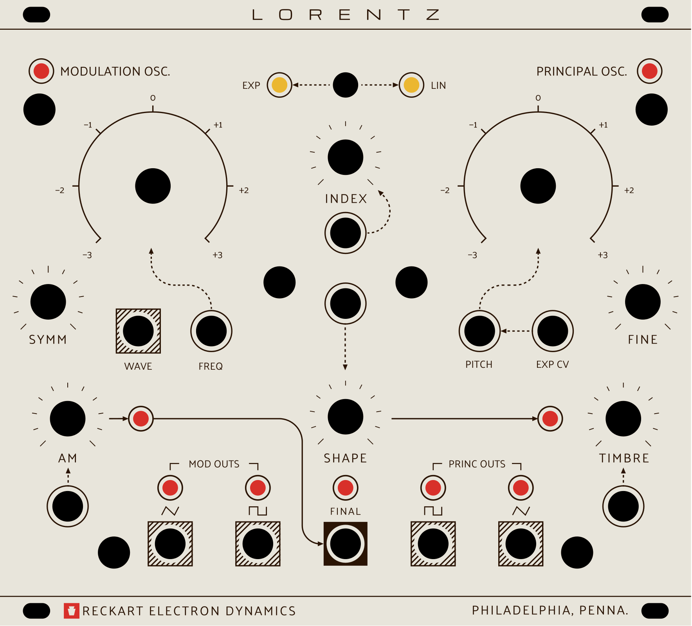
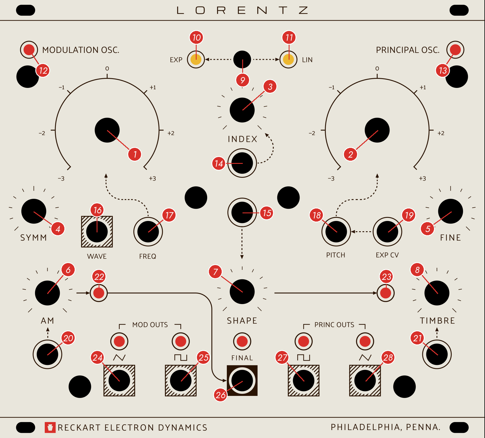
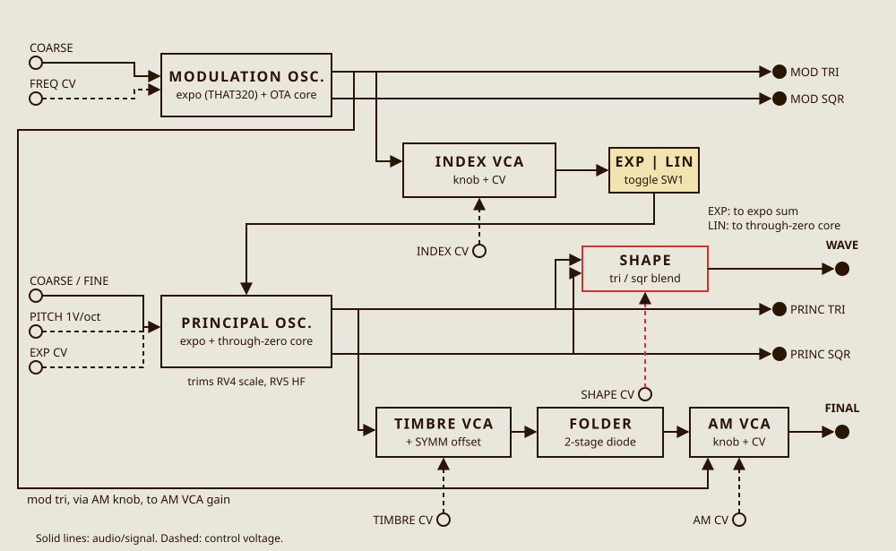
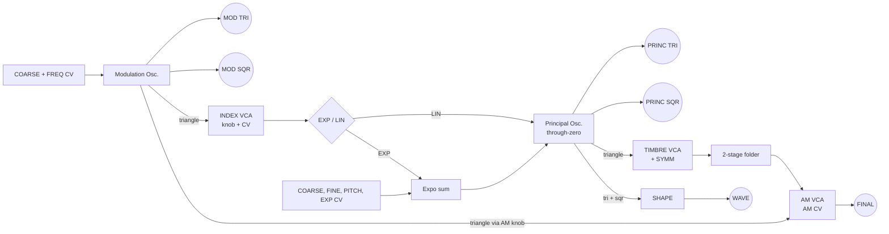

# LORENTZ R-28

**Complex Oscillator. User Manual, REV-A.**

Reckart Electron Dynamics, Philadelphia, Penna.



---

## Contents

1. Introduction
2. Installation
3. Panel overview
4. Modulation Oscillator
5. Principal Oscillator
6. Modulation: INDEX, EXP / LIN and AM
7. Timbre and Shape
8. Outputs
9. Control voltage inputs
10. Lights
11. Patch ideas
12. Calibration
13. Specifications
14. Care

Appendix A. Block diagram
Appendix B. Notes on this revision

---

## 1. Introduction

LORENTZ is a complex oscillator: two analog oscillators in one instrument, built so that one can act on the other. The **Modulation Oscillator** can change the pitch of the **Principal Oscillator** (frequency modulation) and its loudness (amplitude modulation). The Principal Oscillator's triangle then goes through a voltage-controlled **wavefolder**, which adds harmonics by folding the wave back on itself. The result is a single voice that can be anything from a pure tone to bells, gongs, clangs and growls, all under voltage control.

The idea comes from the Buchla Model 259 Programmable Complex Waveform Generator and the "West Coast" approach to synthesis: begin with a simple wave and add harmonics through modulation and waveshaping, rather than beginning with a bright wave and filtering it down. LORENTZ follows that layout and that way of thinking, in a 28 HP Eurorack format with room for the hands.

Both oscillators use an exponential converter built around the THAT320 transistor array, with temperature-compensating resistors. Their cores are built around LM13700 transconductance amplifiers. The Principal Oscillator has a through-zero core, so deep linear FM can drive its frequency through zero and out the other side without stalling.

**Panel conventions.** A few conventions are used throughout the panel:

- CV inputs carry no label. A dotted arrow runs from each one to the knob it acts on.
- Hatched squares mark outputs. FINAL, the main output, has a solid square.
- Amber lights show a mode, and red lights show a signal.
- The six unlabelled round holes, beside the dials, in the centre and in the bottom corners, carry the screws that hold the board stack to the panel. They are not controls.

## 2. Installation

**Power.** LORENTZ takes ±12 V from a standard Eurorack 10-pin power header (2 × 5, 2.54 mm). It does not use +5 V.

- **Pins 1 and 2 are −12 V.** Align the red stripe of the ribbon cable with −12 V on both the module and the bus board. The −12 V end is marked on the circuit board silkscreen.
- Both rails go through series Schottky diodes (1N5817), so a cable plugged in backwards should not damage the module. Even so, check the cable before you power up.
- **Current draw: TBD, to be measured.** A design estimate from the schematic is about 95 mA on +12 V and 80 mA on −12 V. Until a unit has been measured, budget at least 120 mA on each rail.

**Mounting.** The module is 28 HP wide and 3U high. It fixes to the rails with four M3 screws through the slots in the panel corners. Turn off the case power before you insert or remove the module. Depth behind the panel is TBD; it is set by the two-board stack plus the power cable.

**Warm-up.** As with any analog oscillator, let LORENTZ warm up for about 20 minutes before you tune it carefully.

## 3. Panel overview



| # | Control | Section |
|---|---|---|
| 1 | Modulation Oscillator dial (coarse frequency) | Modulation Oscillator |
| 2 | Principal Oscillator dial (coarse pitch) | Principal Oscillator |
| 3 | INDEX | Modulation |
| 4 | SYMM | Timbre |
| 5 | FINE | Principal Oscillator |
| 6 | AM | Modulation |
| 7 | SHAPE | Shape |
| 8 | TIMBRE | Timbre |
| 9 | EXP / LIN toggle | Modulation |
| 10, 11 | EXP and LIN lights (amber) | Modulation |
| 12 | Modulation Oscillator light | Lights |
| 13 | Principal Oscillator light | Lights |
| 14 | INDEX CV input | CV inputs |
| 15 | SHAPE CV input | CV inputs |
| 16 | WAVE output | Shape |
| 17 | FREQ CV input | Modulation Oscillator |
| 18 | PITCH input, 1 V/oct | Principal Oscillator |
| 19 | EXP CV input | Principal Oscillator |
| 20 | AM CV input | CV inputs |
| 21 | TIMBRE CV input | CV inputs |
| 22 | AM light | Lights |
| 23 | Wavefolder light | Lights |
| 24, 25 | MOD OUTS: triangle, square | Outputs |
| 26 | FINAL output | Outputs |
| 27, 28 | PRINC OUTS: square, triangle | Outputs |

Each of the nine red signal lights sits next to the signal it shows. The lights above the five bottom jacks show those outputs.

## 4. Modulation Oscillator

The left side of the panel holds the Modulation Oscillator. Its triangle wave is the modulation source for INDEX (frequency modulation) and AM (amplitude modulation). Both of its waves also have their own outputs, so it can be used as a second oscillator or as an audio-rate LFO.

**Dial (1).** This sets the frequency. Clockwise raises it, on an exponential scale. The Modulation Oscillator dial covers a much wider span than the engraving suggests: about ±7 octaves (nominal, from design), from about 0.1 Hz fully counter-clockwise to about 1.6 kHz fully clockwise, so one dial goes from slow LFO sweeps to audio-rate FM. The −3 to +3 engraving is only a set of landmarks on this dial; each engraved step is a little over two octaves. With the dial at 0 and nothing patched, the design centre is about 13 Hz (nominal, from design).

**FREQ (17).** This CV input adds to the dial, at about 1 V per octave (nominal, from design; it is not trimmed). Positive voltage raises the frequency. Patch the same pitch CV to FREQ and to PITCH, and the two oscillators will track together approximately. Positive voltage takes it above the top of the dial, well into the audio range. Negative voltage takes it below about 0.1 Hz, into very slow LFO rates.

**Outputs (24, 25).** The triangle and square appear at MOD OUTS. Their lights follow the waves.

The Modulation Oscillator has no FM input of its own, and no calibration trimmers.

## 5. Principal Oscillator

The right side of the panel holds the Principal Oscillator: the voice you hear. It is the oscillator that receives the modulation, and it feeds the Timbre section and the FINAL output.

**Dial (2).** This sets the coarse pitch. It is engraved −3 to +3 in octaves, and by the design its span matches the engraving: about ±3 octaves (nominal). The design centre frequency is TBD and has to be measured.

**FINE (5).** This is a fine-tuning control of about ±1 semitone (nominal, from design).

**PITCH (18).** This is the calibrated 1 V/octave input for a keyboard or sequencer. Its scale is set by trimmer RV4 (see Calibration).

**EXP CV (19).** This is a second exponential CV input. It sums with PITCH at about 1 V per octave, untrimmed. Use it for vibrato, glide from a slew limiter, or an envelope sweeping the pitch. The dotted arrow from EXP CV to PITCH on the panel shows that they add together.

**Outputs (27, 28).** The square and triangle appear at PRINC OUTS. The triangle is also the source for the Timbre section.

A high-frequency compensation trimmer, RV5, keeps the top octaves in tune.

## 6. Modulation: INDEX, EXP / LIN and AM

**INDEX (3)** sets how much of the Modulation Oscillator's triangle reaches the Principal Oscillator's frequency. Fully counter-clockwise means no FM. Turning it clockwise brings in sidebands, at first gently, then densely. At full INDEX the modulation is very deep.

**INDEX CV (14)** adds to the knob. With the knob at zero, +10 V gives roughly the same depth as the knob at half-way (nominal). Negative voltage reduces the depth, down to zero.

**EXP / LIN toggle (9)** chooses where the FM goes:

- **Left: EXP.** The EXP light (10) lights. Modulation goes into the Principal Oscillator's exponential pitch sum, like a fast vibrato. The result is musical and familiar, but because the modulation is exponential the average pitch moves as INDEX rises.
- **Right: LIN.** The LIN light (11) lights. Modulation goes to the through-zero core as linear FM. The average pitch stays put as INDEX rises, so harmonic ratios hold and bell and metal tones stay in tune. By the design, the modulation reaches through-zero near the top of the INDEX travel. This is where LORENTZ is most itself.

**AM (6)** is an attenuator for the Modulation Oscillator's triangle, which then varies the loudness of the FINAL output. Fully counter-clockwise means no AM. At slow rates this gives tremolo. At audio rates it gives sidebands that are different from FM. At full AM the signal is modulated past 100%, and goes briefly silent at each trough. The AM light (22) shows the attenuated triangle.

**AM CV (20)** varies the gain of the same amplifier from outside. Positive voltage makes it louder: +10 V roughly doubles the resting level. Negative voltage makes it quieter: about −10 V closes it. An envelope here turns FINAL into a complete voice with no external VCA.

## 7. Timbre and Shape

**TIMBRE (8)** drives the Principal Oscillator's triangle into a two-stage diode wavefolder. At low settings the wave is nearly a triangle. As you turn it up, the peaks fold over, then fold again, adding bright, hollow and vocal harmonics. A little drive remains even fully counter-clockwise, so FINAL is never fully clean. The wavefolder light (23) shows the folder's output.

**TIMBRE CV (21)** adds to the knob. With the knob at zero, +10 V adds roughly as much drive as half the knob's travel (nominal). An envelope here gives the classic brightening attack.

**SYMM (4)** adds a DC offset of about ±0.65 V (nominal) to the wave before it enters the folder. At the centre the folding is symmetrical, so mostly odd harmonics. Away from the centre the folding becomes lopsided and even harmonics appear. SYMM sits on the left of the panel, but it acts only on the Principal Oscillator's Timbre path.

The signal path for FINAL is: Principal triangle → TIMBRE drive (with SYMM) → wavefolder → AM amplifier → FINAL.

**SHAPE (7)** blends the Principal Oscillator's triangle and square. Fully counter-clockwise is the triangle and fully clockwise is the square. The result goes to the **WAVE** output (16), at about ±5 V. This is a separate path from FINAL; SHAPE does not change the FINAL output.

**SHAPE CV (15)** moves the blend further toward the square, starting from the knob's setting. +8 V takes it about all the way to the square from wherever the knob is. Above about +8 V a clamp holds the blend at the square, so +10 V (or more) does not overshoot; WAVE stays at about ±5.3 V. With the knob fully clockwise, the wave is already square and SHAPE CV has no further effect. The input responds only to positive voltage; 0 V or negative leaves the blend at the knob setting.

## 8. Outputs

All outputs are buffered by TL074 op-amps through 1 kΩ. Levels are nominal, calculated from the schematic, and still need to be measured on the bench.

| # | Output | Signal | Level (nominal, from design) |
|---|---|---|---|
| 24 | MOD OUTS, triangle | Modulation Oscillator triangle | about ±6.0 V |
| 25 | MOD OUTS, square | Modulation Oscillator square | about ±5.8 V |
| 28 | PRINC OUTS, triangle | Principal Oscillator triangle | about ±5.2 V |
| 27 | PRINC OUTS, square | Principal Oscillator square | about ±5.4 V |
| 26 | FINAL | Folded, amplitude-modulated Principal | TBD, depends on TIMBRE and AM |
| 16 | WAVE | SHAPE blend of Principal triangle and square | about ±5.1 V (triangle) to ±5.3 V (square); SHAPE CV is clamped at the square |

## 9. Control voltage inputs

Each input has no attenuator of its own. Its voltage adds to the knob it points to, so the knob sets the starting point. Unpatched inputs are held at 0 V.

| # | Input | Acts on | Scale (nominal, from design) | Input impedance |
|---|---|---|---|---|
| 17 | FREQ | Modulation Oscillator frequency | about 1 V/oct, untrimmed | 110 kΩ |
| 18 | PITCH | Principal Oscillator pitch | 1 V/oct, trimmed by RV4 | about 110 kΩ |
| 19 | EXP CV | Principal Oscillator pitch | about 1 V/oct, untrimmed | 110 kΩ |
| 14 | INDEX CV | FM depth | +10 V is about half the knob's travel | 330 kΩ |
| 21 | TIMBRE CV | Wavefolder drive | +10 V is about half the knob's travel | 330 kΩ |
| 20 | AM CV | AM amplifier gain | +10 V roughly doubles the level; −10 V closes it | 200 kΩ |
| 15 | SHAPE CV | SHAPE blend | +8 V is about a full triangle-to-square sweep; clamped above; positive only | 143 kΩ |

The two untrimmed 1 V/oct inputs, FREQ and EXP CV, are about 2% wide by the resistor values. That is fine for modulation, but use PITCH for playing in tune.

## 10. Lights

**Amber: mode.**

- **EXP (10)** is lit when the toggle is to the left.
- **LIN (11)** is lit when the toggle is to the right.

**Red: signal.** Each red light is driven by a buffer from the signal it shows. It lights on the positive half of the wave, so at low rates it flashes and at audio rates it glows steadily.

| # | Shows |
|---|---|
| 12 | Modulation Oscillator triangle |
| 13 | Principal Oscillator triangle |
| 22 | AM: the Modulation triangle after the AM knob |
| 23 | Wavefolder output |
| 24, 25 lights | Modulation triangle, Modulation square |
| 26 light | FINAL |
| 27, 28 lights | Principal square, Principal triangle |

## 11. Patch ideas

Start each patch from a neutral state: INDEX, AM and TIMBRE fully counter-clockwise, SYMM at the centre, both dials at 0, toggle on LIN.

**1. Struck bell**

```
Sequencer CV --> PITCH (18)    and --> FREQ (17)
Envelope     --> AM CV (20)    and --> TIMBRE CV (21)
FINAL (26)   --> mixer
```

Set the Modulation dial a non-whole ratio above the Principal (try +1.4). Put the toggle on LIN and INDEX at about 10 o'clock. A short envelope strikes the bell. Its decay closes the AM amplifier and softens the folds together.

**2. West Coast pluck**

```
Sequencer CV --> PITCH (18)
Gate/env     --> TIMBRE CV (21)
FINAL (26)   --> low-pass gate
```

Use no FM. Set TIMBRE to about 11 o'clock and SYMM slightly off-centre. The envelope opens the folder for a bright, rubbery attack.

**3. Through-zero clang**

Keep the toggle on LIN. Tune the Modulation Oscillator about an octave below the Principal and raise INDEX toward full. Near the top of its travel the Principal goes through zero, and the tone turns metallic and inharmonic while keeping its root. Send a slow LFO to INDEX CV (14) to move in and out of the clang.

**4. Siren and drone**

```
MOD square (25) --> EXP CV (19)
```

Put the toggle on EXP. Turn the Modulation dial well counter-clockwise for a slow rate (fully counter-clockwise is about 0.1 Hz). INDEX adds triangle vibrato, and the patched square adds a two-step siren. Bring up TIMBRE and AM for a drone that moves by itself.

**5. Two voices**

```
Pitch CV --> mult --> PITCH (18), FREQ (17)
MOD triangle (24) --> mixer
FINAL (26)        --> mixer
```

With INDEX and AM at zero, the oscillators are independent. Tune the Modulation dial to a fifth or an octave and mix its triangle against the folded Principal. Small amounts of INDEX then tie the two voices together.

**6. Self-modulating timbre**

```
MOD square (25)  --> TIMBRE CV (21)
PRINC square (27) --> AM CV (20)
```

Each square switches the timbre or the level. With the Modulation Oscillator slow, this is rhythmic. At audio rates it becomes a grainy, complex tone.

## 12. Calibration

LORENTZ has three trimmers, all on the rear of the circuit board. RV4 and RV5 are on either side of the power header along the bottom edge; RV11 is right of centre, about 26 mm above the bottom edge, near the SHAPE circuitry (U13). Check the silkscreen for their exact positions.

| Trimmer | Value | Sets |
|---|---|---|
| RV4 | 20 kΩ | Principal Oscillator 1 V/oct scale (PITCH input) |
| RV5 | 10 kΩ | Principal Oscillator high-frequency tracking |
| RV11 | 100 kΩ | SHAPE CV offset null (stops SHAPE CV from shifting the WAVE DC level) |

RV4 and RV5 set pitch; RV11 is independent of them and can be done at any time. The Modulation Oscillator and the EXP CV input have no trimmers. Their scale comes from fixed resistors and the tempco resistors.

**You will need:** a precise voltage source or a calibrated keyboard/MIDI-CV interface (1.000 V steps), a tuner or frequency counter, and a small screwdriver. A voltmeter is helpful.

**Procedure:**

1. Power the module in the case and let it warm up for at least 20 minutes.
2. Set INDEX and AM fully counter-clockwise and FINE to the centre. Unpatch everything except PITCH (18).
3. Patch PRINC OUTS, triangle (28) to the tuner.
4. **Scale (RV4).**
    - Send 1.000 V to PITCH, and set the Principal dial so the tuner reads a convenient note, around 65 Hz (C2).
    - Send 3.000 V. The tuner should read exactly two octaves higher.
    - If it is flat, turn RV4 one way, and if it is sharp, the other.
    - Return to 1 V, retune with the dial, and repeat until 1 V and 3 V are exactly two octaves apart.
5. **High-frequency tracking (RV5).**
    - Send 5.000 V and then 6.000 V. If the top octave reads flat, adjust RV5 until it is correct.
    - RV5 interacts with RV4, so repeat step 4, then step 5, until both ranges are right.
6. Check the result across the playing range, ±3 octaves around your normal tuning.
7. **SHAPE CV offset null (RV11).**
    - Turn SHAPE (7) fully clockwise (square). In this position the blend signal is zero, so anything SHAPE CV does to WAVE is offset error.
    - Patch WAVE (16) to a voltmeter on DC, or to a DC-coupled scope. With the oscillator running, read the average (mid-point) level of the square.
    - Switch SHAPE CV (15) between 0 V and +8 V. Adjust RV11 until the WAVE DC level does not move when the CV switches. Aim for less than 10 mV of change.
    - Without the adjustment, the OTA's input offset can shift WAVE by several hundred millivolts (up to a few volts in the worst case) as SHAPE CV rises.

Tracking accuracy and usable range are TBD until the first unit is measured.

## 13. Specifications

| Item | Value |
|---|---|
| Format | Eurorack 3U, 28 HP |
| Panel | 141.9 × 128.5 mm, 2.0 mm aluminium; off-white or black |
| Depth | TBD |
| Power | ±12 V, 10-pin Eurorack header; series Schottky reverse protection on both rails; no +5 V |
| Current draw | TBD (design estimate about 95 mA +12 V, 80 mA −12 V) |
| Construction | Two-board stack: control board and circuit board |
| Expo converter | THAT320 PNP array with +3300 ppm/°C tempco resistors |
| Oscillator cores | LM13700 OTA integrators, LM319 comparators, CD4053 switching; Principal is through-zero |
| Controls | 8 potentiometers, 1 toggle (EXP / LIN) |
| Inputs | 7 (FREQ, PITCH, EXP CV, INDEX, TIMBRE, AM, SHAPE) |
| Outputs | 6 (MOD triangle, MOD square, PRINC triangle, PRINC square, FINAL, WAVE), 1 kΩ |
| Lights | 9 red (signal), 2 amber (mode) |
| Pitch input | 1 V/oct, trimmed (RV4) with HF compensation (RV5) |
| Trimmers | 3 (RV4 scale, RV5 HF tracking, RV11 SHAPE CV offset) |
| Modulation Oscillator range | Dial about 0.1 Hz to 1.6 kHz, centre about 13 Hz; FREQ CV extends it (nominal, from design) |
| Principal Oscillator dial | About ±3 octaves (nominal, from design) |
| Frequency ranges | TBD |
| Output levels | See section 8 (nominal, from design) |

## 14. Care

Keep LORENTZ dry and away from strong heat. Clean the panel with a soft, dry or barely damp cloth. Do not use solvents, which can damage the printing. Do not over-tighten the jack nuts or the toggle nut. Leave the six board-stack screws in place.

Hand-made by Tyler Reckart in Philadelphia.

---

## Appendix A. Block diagram





## Appendix B. Notes on this revision

These points come from checking this manual against the REV-A schematics. They are recorded here so that the manual and the hardware stay honest with each other.

1. **SHAPE and WAVE.** The WAVE amplifier (U12B) has a 100 kΩ feedback resistor (R131), and the SHAPE CV amplifier output (SC_V) is summed in through 42.2 kΩ (R132). The SHAPE knob blends triangle and square, and SHAPE CV moves the blend, as described in section 7. SHAPE CV enters through 143 kΩ (R112); a 6.8 V zener (D45) across the SHAPE CV converter limits the OTA bias so that the blend stops at the square above about +8 V instead of overshooting. RV11 with R133 (470 kΩ) nulls the SHAPE OTA's input offset (see Calibration, step 7). SHAPE CV is positive-only by design: the SHAPE knob is a passive audio crossfade, so a negative CV cannot move the blend back toward the triangle.
2. **Dial scale.** The Principal dial resistor (R26) is 442 kΩ, which gives about ±3 octaves to match the engraving. The Modulation dial (R4 187 kΩ, with a 10 nF timing capacitor) is deliberately wider, about 0.1 Hz to 1.6 kHz, so its engraving is only a set of landmarks.
3. **Lights.** D43 and D44 (EXP and LIN) are 3 mm amber LEDs, to match the panel. The other nine lights are 3 mm red.
4. **Not yet measured:** current draw, depth, frequency ranges, output levels, tracking accuracy and the through-zero behaviour. All figures marked nominal come from the schematic and simulation.

LORENTZ R-28. Reckart Electron Dynamics, Philadelphia, Penna. REV-A.
